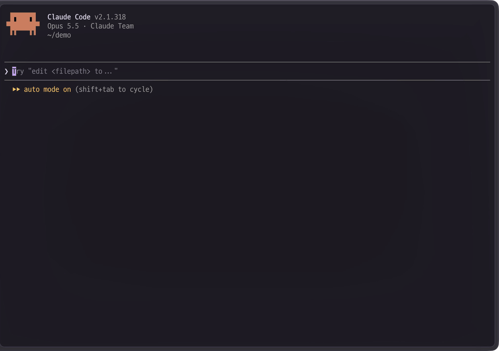

# rex-paste

> [!WARNING]
> Rex is in beta. Its server API and Lua runtime can change in any release, so rex-paste may
> stop working after a Rex update without warning.

A screenshot on your Mac can't reach Claude Code or Codex running in a Rex terminal, and
when that terminal is on a remote host you need `scp` or a shared folder just to hand over
one image.

rex-paste pastes clipboard images and files into Rex terminals, local or remote, with one
key. <kbd>Cmd</kbd>+<kbd>Shift</kbd>+<kbd>V</kbd> pastes a path the program in the terminal
can read. In a remote session the file is sent to the host first.



- **One key, any host.** Files travel over the Rex connection you already have, so you need
  no `scp`, shared folder, SSH setup, or open port.
- **Fast.** Chunks go out in parallel over many connections, so a 16 MiB file reaches a
  remote host in a few seconds. A file the host already has is not sent again.
- **Ready for AI tools.** Images are downscaled and saved as lossless WebP, so they stay
  small and readable.
- **Safe.** Every file is checked with SHA-256 before its path is pasted. rex-paste never
  presses Enter, and a file name can't act as a key press.

## Get started

1. Check what you need. The Mac needs the Rex app on macOS 26 or later (Apple silicon). A
   remote host needs a Rex server on Linux (x86_64 or aarch64) or macOS.

2. Install on the Mac:

   ```sh
   curl -fsSL https://github.com/jeongjinku/rex-paste/releases/latest/download/install.sh | sh
   ```

3. Install on every remote Linux or macOS host you paste into. Run the same command in a shell on the host,
   for example in a Rex terminal connected to it.

4. That's it. Copy a screenshot or a file in Finder, then press
   <kbd>Cmd</kbd>+<kbd>Shift</kbd>+<kbd>V</kbd> in a Rex terminal.

The installer puts the plugin in `~/.config/rex/rex-paste`, checks it against the release's
`SHA256SUMS`, and reloads the Rex config. On the first install it adds this to the Mac's
`~/.config/rex/init.lua`, and skips the binding if <kbd>Cmd</kbd>+<kbd>Shift</kbd>+<kbd>V</kbd>
is already bound there:

```lua
require("rex-paste").setup()
rex.bind("cmd+shift+v", "rex_paste")
```

A host gets only the `require` line. It needs no key binding, because the Mac's bindings apply
in every session.

## Usage

<kbd>Cmd</kbd>+<kbd>V</kbd> stays Rex's normal paste. <kbd>Cmd</kbd>+<kbd>Shift</kbd>+<kbd>V</kbd>
pastes based on what the clipboard holds:

| Clipboard | Local session | Remote session |
|---|---|---|
| Image (screenshot, image data, image file) | Prepared image's path | Prepared image sent, its path pasted |
| Other file from Finder | Original path | File sent unchanged, its path pasted |
| Text | Pasted as text | Pasted as text |

A prepared image is downscaled to fit 2000 px and saved as lossless WebP. Alpha, ICC
profiles, and EXIF orientation are kept, and originals are never modified. A transfer that
takes more than a second shows a progress bar over the terminal.

### Actions

Search for `rex-paste` in the command palette, or run `rex do <name>`.

| Palette title | Name | What it does |
|---|---|---|
| rex-paste: paste clipboard image, file, or text | `rex_paste` | Pastes the clipboard into the focused terminal |
| rex-paste: receive a transfer (internal) | `rex_paste_receive` | Used by the Mac to send chunks to a host |

To use another key, bind it to `rex_paste` in `~/.config/rex/init.lua`.

## Update

Once a week the Mac checks GitHub for a newer release. If there is one, the next paste shows
a notice; press <kbd>n</kbd> to hide it for that release. To update, run the install command
again on the Mac and every host. All of them must run the same version: pastes into a host
with another version fail, and a notice says what to run there. To install a specific
version, use its release URL, for example `.../releases/download/v0.1.0/install.sh`.

## Settings

Every option is optional. These are the defaults:

```lua
require("rex-paste").setup{
  max_size      = 16 * 1024 * 1024, -- bytes; one limit for prepared images and regular files
  resize        = true,             -- downscale images to fit max_dimension
  max_dimension = 2000,             -- longest side in pixels
  compress      = true,             -- lossless WebP; false keeps the original format
  connections   = 12,               -- parallel connections per remote host
}
```

- Hosts use only `max_size`. If you change it, set it on the hosts too, because a host
  rejects any transfer over its own limit.
- `compress = false` keeps the image's format. An image that needs no resizing is sent as its
  original bytes. A resized one is re-encoded in its own format, which loses a little quality
  for JPEG and HEIC. Formats other than PNG, WebP, JPEG, TIFF, GIF, HEIC, and AVIF still
  become WebP. Claude can't read HEIC or TIFF, so keep `compress = true` for AI tools.
- An unknown option is logged and ignored. An invalid value fails the config load.

## How it works

With a screenshot pasted into Claude Code on a remote host as the example, it works in this
order:

1. **You press the key.** `rex_paste` runs the helper `bin/rex-paste` to read the clipboard.
   A file copied in Finder wins over its icon, and only the first of several copied files is
   used.
2. **The Mac prepares the image.** It is downscaled and saved as lossless WebP, and its
   SHA-256 is computed.
3. **The Mac sends it.** It keeps a pool of `connections` connections to the host
   (`rex -S <host>`), splits the file into 44 KiB chunks, and sends them in parallel to the
   host's `rex_paste_receive` action. When one connection finishes a chunk, it takes the next
   one. If a connection fails or stays silent too long, it is replaced and its chunk is sent
   once more; a second failure fails the transfer. If the host already has the file, it stops
   the transfer early and reuses its copy.
4. **The host checks and stores it.** It verifies the file's size and SHA-256 and stores it in
   `~/.cache/rex-paste/v2`.
5. **The host pastes the path.** The path goes into your terminal as text, without Enter, and
   Claude Code reads the image from it.

In a local session steps 3 and 4 are skipped, and the path of the prepared image on the Mac is
pasted.

## Security

- Data travels only over the Rex connections you already have. rex-paste opens no ports. Its
  only other network traffic is the weekly update check and `install.sh`'s downloads, both
  from GitHub.
- The cache is readable only by you (`0700`, files `0600`). The host refuses symlinks, hard
  links, files owned by others, and file names with path separators or control characters.
  Cache entries unused for 24 hours are removed on the next paste.
- A path containing control characters is never pasted, so a file name can't act as a key
  press such as Enter.
- rex-paste reads the clipboard only when you run `rex_paste`.

## Limitations

**What can't be sent**

- **Directories and empty files.** Only regular files with content are sent.
- **Animation.** Animated images keep only their first frame.
- **Several files at once.** Only the first of several copied files is used.

**Where it works**

- **Sending from macOS only.** Linux hosts can receive but not send.
- **No drag and drop.** Rex gives plugins no drop event.
- **The same version everywhere.** A host running another version rejects pastes until you
  update it.

**Large or slow transfers**

- **Held in memory.** A transfer is kept in memory. Each chunk request has 10 seconds to
  complete, so a large `max_size` needs a fast link.
- **Partial files.** An interrupted transfer can leave a partial file in the cache until the
  next cleanup.
- **`PoolUnavailable`.** The connection pool could not start. `~/.cache/rex-paste/pool.log` on
  the Mac says why.

## Uninstall

Run this on the Mac and on every Linux or macOS host:

```sh
curl -fsSL https://github.com/jeongjinku/rex-paste/releases/latest/download/install.sh | sh -s uninstall
```

It deletes `~/.config/rex/rex-paste`, removes the lines the installer added to
`~/.config/rex/init.lua`, and reloads the Rex config. If `init.lua` has other lines that use
rex-paste, such as `setup{...}` with options or another key binding, it lists them and changes
nothing; remove them and run it again. Pasted files stay in `~/.cache/rex-paste`; delete it to
remove them too.

## Development

To build, you need [Zig 0.17.0](https://ziglang.org/download/). On macOS you also need the
Xcode command line tools and `brew install libpng webp`.

```sh
sh build.sh                                           # this machine -> bin/rex-paste
sh build.sh linux-x86_64 dist/rex-paste-linux-x86_64  # cross-compile a receiver
python3 test/binary_test.py                           # receiver and pool tests
sh test/clipboard_test.sh                             # macOS clipboard and codecs, private pasteboard
rex do test/actions_test.lua                          # Lua actions with mocked servers
luacheck .                                            # lint Lua
```

`test/e2e_test.lua` pastes from a named pasteboard into a scratch session on a real host. To
run from source, clone the repo into `~/.config/rex/rex-paste` and run `sh build.sh` there;
`install.sh` never overwrites a checkout. A source checkout reports version `dev`. Pushing a
`v*` tag runs `.github/workflows/release.yml`, which builds, packages
(`.github/package.sh`), and publishes the release.

## License

[MIT](LICENSE). The release binaries include third-party code; see
[THIRD_PARTY_NOTICES.md](THIRD_PARTY_NOTICES.md).
